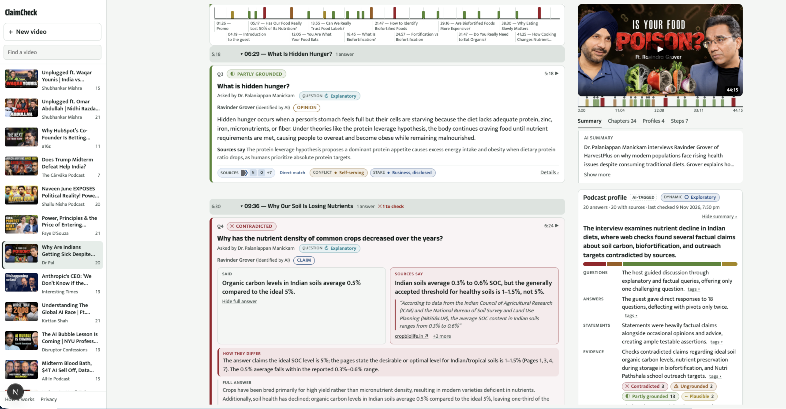

# ClaimCheck

Paste a YouTube link (any public, finished video) and ClaimCheck turns a podcast or interview into a **Q&A you can read
in minutes**: every question the host asked, the answer the guest gave, what the web says about that answer, and how
each was put, so you can see at a glance who dodged, who is selling something, and which answers the sources contradict.

**[Setup guide: run it locally](docs/SETUP.md)** · [How a video is analysed](#how-a-video-is-analysed) · [License: MIT](LICENSE)



*A finished video. Left: the answers in the order they were given, each under its question, with the sources found and
what they say. Right: the pinned player, an AI summary, and the Podcast profile (how the questions were asked, how they
were answered, what the evidence found).*

## What you get on a video

- **Question and answer cards.** The AI's plain-words version of each question (who asked it, and the host's own words
  when they framed it), the answer (who gave it, "identified by AI"), and a play button that cues the video to that moment.
- **Tags on everything, visible without clicking.**
  - *Question*: factual, explanatory, experiential, evaluative, speculative, challenging.
  - *Answer*: direct, narrative, structured, pivot, evasive.
  - *Claim*: objective fact, anchored opinion, pure opinion, prediction.
  - *Evidence*: **Grounded**, **Partly grounded**, **Plausible**, **Contradicted**, **Exempt** (an opinion nothing could check),
    **Ungrounded** (serves the speaker's interest and no outside page supports any of it).
  - *Flags*: conflict of interest (for example "Self-serving") and stake ("Business, disclosed"), set against the speaker's profile.
- **Sources, claim by claim.** Pages found by web search, a one-line TLDR per page, what the pages say together, then each
  checkable claim in the answer compared with them: supported, partly, contradicted or not found, with a reason and a
  quote that really is on the page. A contradicted answer shows **Said / Sources say / How they differ** side by side.
- **Podcast profile.** Pinned beside the video, no tabs: a one-sentence TL;DR and a tally per tag for the whole video
  (Questions, Answers, Statements, Evidence, Flags), plus the interview dynamic (promotional, neutral or adversarial).
- **Profiles of the show and the people.** Who hosts it, who is speaking, what they do, own, sell and have a stake in,
  each fact linked to the page it came from. Tabs under the player: Summary, Chapters, Profiles, Steps (what was done).
- **A chapter track** over the feed and one tick per answer on the player's timeline, colored by evidence.

The tags and labels are **AI-assessed**: a model reads the video and the pages, and code checks every quote, page
number and label rule afterwards. The model never writes the evidence label itself; code derives it from the claim-by-claim findings.

> ClaimCheck is an AI tool, not a newsroom. Labels describe how an answer relates to the pages that were found, not
> whether anyone is right. Earlier versions published verdicts and were reworked into this;
> old verdict data stays in the database but is hidden from the public (migration 0012). The design of that earlier
> version is in [`docs/archive/`](docs/archive/REPORT-verdict-version.md).

```
pipeline/   Python service: Google ADK agents + guardrails (Cloud Run)
web/        Next.js 16 app: feed, video page, Q&A pages, channels, reviewer page (Vercel)
supabase/   Postgres schema (29 migrations), row-level security and column grants
docs/       preview.png (the screenshot above) and archive/ (the superseded verdict-version report)
```

## Run it locally

Needs Docker, the Supabase CLI, Python 3.11+, Node 20+, and three API keys (Google AI Studio, Parallel, YouTube Data).
There is no demo data: the app shows only videos you submit. **Step-by-step guide with the env files, costs and
troubleshooting: [`docs/SETUP.md`](docs/SETUP.md).** The short version:

```bash
supabase start && supabase db reset        # local Postgres with migrations 0001-0029 (ports 55321-55329)

cd pipeline
python3 -m venv .venv && . .venv/bin/activate
pip install -e ".[dev]"
cp .env.example .env                       # GOOGLE_API_KEY, PARALLEL_API_KEY, YOUTUBE_API_KEY, Supabase keys
pytest                                     # 224 tests, all offline, no keys needed
python -m claimcheck.cli "https://www.youtube.com/watch?v=VIDEO_ID"
python -m claimcheck.cli --sources CLAIM_ID        # look up sources for one answer, as the button does
python -m claimcheck.cli --sources-all EPISODE_ID  # "Check sources for all statements"
python -m claimcheck.cli --qa EPISODE_ID           # (re)write the Q&A index of a finished video
python -m claimcheck.cli --tldr EPISODE_ID         # (re)write the podcast profile's TL;DRs (--no-save to just print)
python -m claimcheck.cli --relink-channels         # videos saved without a channel get it (and their creator)
uvicorn claimcheck.server:app --port 8080  # the service the web app calls

cd ../web
cp .env.example .env.local                 # Supabase URL/keys from `supabase status`
npm install && npm run dev                 # http://localhost:3000
```

Every model defaults to `gemini-3.5-flash-lite`; see "Model names, limits and prices" below. Searches go through Parallel.

## The web app

| Route | Screen |
| --- | --- |
| `/` | Paste a link to analyse a video, and the sidebar list of videos already analysed (searchable) |
| `/v/VIDEO_ID` | The video page. A feed of questions grouped by chapter, each answer's card filling in live while its sources are looked up (Supabase Realtime, polling if it is off). Pinned on the right: the player (loads only on tap, YouTube's own defaults), tabs Summary / Chapters / Profiles / Steps, and the Podcast profile. While a video is analysed: a step checklist. A failed run says what happened and offers a retry |
| `/v/VIDEO_ID#claim-ID` | Same, cued to that answer. Also `?moment=ID`, `?t=640`, `?play=1` |
| `/qa/VIDEO_ID` | A shareable, indexable Q&A page of a finished video: the questions a reader would ask, each answered with the statements as extracted and the sources found, never with new model text |
| `/c/CHANNEL_ID` | A channel's analysed videos |
| `/submit` | Analyse a video (with link preview) |
| `/method`, `/privacy` | How it works (limits of AI output, what isn't shown, reporting); privacy and YouTube terms |
| `/review` | Reviewer (HTTP basic auth): open reports (hide an answer, mark fixed, nothing wrong) and the videos list (stop, delete) |
| `/episode/ID` | Old scorecard URL; redirects to `/v/VIDEO_ID` |

Nothing is drawn over YouTube thumbnails or the player, the player's speed and captions are YouTube's defaults, and
it is never shrunk below 200x200, per YouTube's API policies.

## How a video is analysed

```
EpisodePipeline (ADK SequentialAgent)                       POST /episodes
  IngestGate        code   public and finished (not live); title/description treated as untrusted
  PeopleProfiler    code   the show's profile (curated top-100, cached, or from the web), then who appears (hosts, people the
                           description names, a model over the title plus one search) and each person's profile and incentive tags.
                           Done first, so every answer is read against its speaker's profile
  ExtractorAgent    LLM    reads the YouTube URL (agentic video processing): each question with who asked it, and the answer with
                           who gave it and its timestamp; the chapters of the conversation and a neutral summary. Answers are
                           saved as they are written, so the page fills in while the video is still being read
  ClaimFilter       code   150-answer cap; content policy applied in code; chapters cleaned (time order, no overlaps)
  SpeakerProfiler   code   anyone the extractor named who wasn't profiled yet
  InterviewTagger   ADK    every question's type, and the interview dynamic, in batched classifier calls. The classifier
                           sees the questions only, never an answer
  Publisher         code   the only writer; marks the video done

The viewer sees the steps as a checklist (episodes.progress.steps) and afterwards under the Steps tab (episodes.steps).
```

### Answer tags, research and assessment (`agents/batch.py`, `qa_tags.py`, `research.py`, `assess.py`)

Run for a whole video together (`CLAIMCHECK_BATCH_LOOKUPS=1`, the default), or for one answer from its button:

```
1 classify   a classifier call (several answers by one speaker per call): answer type, claim type, and, for every
             answer whose speaker has a profile, whether it touches their stake, whether it is a self-serving pivot, and
             whether the stake was disclosed. A pure opinion is Exempt: no planner, no search
2 plan       one planner call writes the 1-2 most checkable points of each answer and new queries (not the answer's own
             sentence), including challenge queries for other figures or positions. Answers on one subject share a search
3 search     one Parallel request carrying the queries. The excerpts it returns are the only page text used; every page is kept,
             in the order returned. Pages from the episode itself or the speaker's own organisation are labelled (never hidden)
4 assess     one call per answer: a TLDR per page, what the pages say together, then each claim compared with the pages
             (supported / partly / contradicted / not_found) with the page, a quote and a reason
```

Code then decides, never the model: a page number must be one shown; a quote must be on that page or it is dropped; a
"contradicted" claim without a quotable page becomes "partly"; the evidence label follows from the claims
(contradicted if any is, grounded if all are supported, partly grounded if some are, plausible if no page settles any); a
Choice below the sure threshold falls back to the cautious label; and Ungrounded needs an incentive-linked answer with no
independent page supporting it. A failed call leaves the answer untagged and retryable; a budget error is never swallowed.

Every answer has a `sources_status`: `not_eligible`, `not_requested`, `queued`, `searching`, `done` or `failed` (can be
retried). A pipeline restart marks interrupted ones `failed`. The podcast profile's TL;DRs (`agents/tldr.py`) are counted
in code first, so every number in them is exact, and rewritten after answers are checked.

Creator and speaker profiles keep a private side (known positions, criticisms, two judgement-based incentive tags) that
only steers the skepticism rules and the second source search; the database never sends it to the browser (generated
`public_profile` columns, column grants).

## Guardrails (`pipeline/claimcheck/guardrails/`, `policy.yaml`)

| Where | Rule |
| --- | --- |
| Every model call | Per-video cost cap ($3) via an ADK plugin, covering the first pass and every search ($0.005 each); counts prompt, output, thinking **and tool-use** tokens (agentic video bills frames and transcript as tool use). Prices in `config.py` use the later published Flash price so the cap never undercounts. Model Armor plugin when templates are configured |
| Prompts | Describe, never advise; labels come from code over quote-backed findings. All video text and fetched pages are wrapped as untrusted data; instruction-like lines in pages are removed |
| Quotes | A quote is kept only if it really is on the page it is attributed to; a label that needs a quote falls back without one |
| Buttons | 10 "Check sources" per person per day and 120 per hour site-wide, 3 "Check sources for all" per person per day and 20 per hour (`SOURCES_*` env vars; 0 disables). Submissions: 5 per person per day |
| Sources | Plain web search, social media and video sites excluded in the request; site kinds are display only and never hide a result |
| Content policy | Religious beliefs, claims about whole communities/castes/religions, private individuals and minors, live court cases, disasters in the first 48 h, satire: stored redacted and never shown |
| Reports | "Report a problem" on every answer goes to `/review`; a reviewer can hide an answer for everyone |
| YouTube data | Refreshed every 25 days by the daily maintenance cron (YouTube allows 30); videos no longer public are marked `removed` and hidden; no channel avatars stored |
| Privacy | Salted IP hashes only, for rate limits; deleted after 30 days by the maintenance cron |

All of these are covered by tests in `pipeline/tests/` (224 tests, offline).

## Going live

1. **Supabase**: create a project and run every migration in order (`supabase db push`, or the SQL editor):
   `0001`-`0029`. An existing database only needs the ones it's missing. Highlights: `0012` hides old verdicts and
   adds sources; `0018` the 100 curated creator profiles; `0019` speakers, chapters and counter-sources; `0020`-`0021`
   the Q&A index and each answer's question; `0023` research and page independence; `0025` the tagging taxonomy and
   incentive tags; `0026` saved steps; `0027` Realtime on claims; `0029` failed videos stay visible. After 0019, run
   `python -m claimcheck.cli --relink-channels` once. If 0006-0011 were applied by hand (not through the CLI), apply
   the later ones the same way: `supabase migration up` would re-run 0006's backfill. Deploy order: migration, then
   pipeline, then web.
2. **Pipeline (Cloud Run)**: `cd pipeline && gcloud run deploy claimcheck-pipeline --source . --set-env-vars ...` with
   `GOOGLE_API_KEY`, `PARALLEL_API_KEY`, `YOUTUBE_API_KEY`, `SUPABASE_URL`, `SUPABASE_SERVICE_ROLE_KEY`,
   `PIPELINE_SHARED_SECRET`, optionally `MODEL_ARMOR_*`. Request timeout 60 min, CPU always allocated, and
   `--max-instances=1` (runs and the per-video lock live in memory).
3. **Web (Vercel)**: import `web/`, set the variables in `web/.env.example`, including `NEXT_PUBLIC_CONTACT_EMAIL`,
   `REVIEW_PASSWORD` and `CRON_SECRET`. `vercel.json` runs `/api/cron/maintenance` daily (allowed on Hobby).
4. **Gold set**: label ~20 videos in `pipeline/evals/gold_set.example.jsonl` format and run
   `python -m evals.run_eval your_gold.jsonl`. Gates: extraction recall >= 80%, tag agreement >= 80%.

Model names, limits and prices are environment variables (`CLAIMCHECK_FAST_MODEL`, `CLAIMCHECK_SUMMARY_MODEL`,
`CLAIMCHECK_TAG_MODEL`, `CLAIMCHECK_PROFILE_MODEL`, `CLAIMCHECK_PRICES_JSON`, `CLAIMCHECK_MAX_COST_USD`,
`CLAIMCHECK_BATCH_LOOKUPS`, `CLAIMCHECK_AUTO_SOURCES`, `CLAIMCHECK_RESEARCH_MAX_SEARCHES`,
`CLAIMCHECK_VIDEO_PROCESSING=static` for the fallback, ...); see `pipeline/claimcheck/config.py` and `pipeline/.env.example`.

## What has and hasn't been verified

Verified: all pipeline tests; the migrations on a local Supabase; web typecheck and production build; the pages in a
real browser against local data.

Not run in production: there is no deployed instance yet; ClaimCheck runs locally only. Expect a shakedown on the first
live deploy, in particular that agentic video processing doesn't silently fall back to static, and that tool-use tokens
show up in the cost.

Before launch: have a lawyer review the content policy, the evidence labels, the reporting process and the IT Rules 2021
obligations for digital publishers.

## License

MIT, see `LICENSE`.
